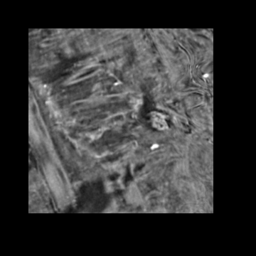

# PHerc. 800 validation

The main comparison uses the same native GrowPatch object (`ba33b7b1-5462-4dcc-ac43-f0c92c5f834b`) in separate copies of the project. It is bound to CT volume `20250521135224`. The exported grid is 18 × 18. The test is about making the geometry available to downstream tools; it does not assess the quality of the trace.

| Run | Input and operation | Result |
| --- | --- | --- |
| macOS release `740f010` | Native GrowPatch surface; VC3D `objects.export` | [Failed; no files](macos-release-before.json) |
| macOS release `740f010` | A surface imported from TIFXYZ; same VC3D operation | Succeeded; isolates the native metadata path |
| macOS build `14d4e725`, before | Original native surface; VC3D `objects.export` | [Failed; no files](macos-same-revision-before.json) |
| macOS build `14d4e725` + patch, after | Same surface; same VC3D operation | [Succeeded; five files](macos-patched-after.json) |
| Fixed exporter `14d4e725` + patch, Ubuntu 24.04 arm64 | Same native surface; export, reimport and compare arrays | [Passed](round-trip.txt) |

The macOS GUI was run with its official local JSON-RPC bridge. Both builds used the same OpenCV 4 and LLVM 23 toolchain and the same [build-only include](../repro/llvm23-include.patch). All five files written by the fixed VC3D app were byte-identical to the independently reimported CLI output. The visual scene is unchanged; the [before](macos-before.png) and [after](macos-after.png) screenshots show the same surface, and the export job results show the behavioral change. The [release close-up](macos-release-view.png) shows the patch in cross-section.

## Downstream rendering

The stock macOS `vc_render_tifxyz` read the file exported by the fixed GUI and produced a 360 × 360 center slice. Its TIFF matched the center slice rendered directly from the original VC3D store, byte for byte. The SHA-256 of both TIFF files is `c0488a189fc13d0a61ead34e9f4cb4c3d70eaee679b2f6d5a307e9b479886263`.

Scan imagery in this directory is derived from [PHerc. 800, provided by Vesuvius Challenge](https://scrollprize.org/data_browser/PHerc0800), [CC BY-NC 4.0](https://creativecommons.org/licenses/by-nc/4.0/). The PNG is a presentation copy of the output TIFF.
