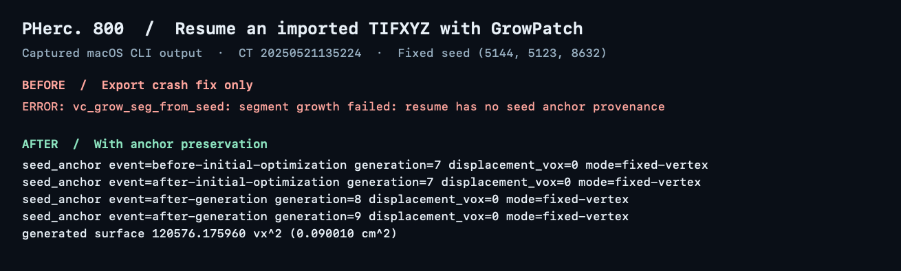

# Resume an anchored GrowPatch after a TIFXYZ transfer

This follow-up used the public [PHerc. 800 CT and m7 prediction](https://scrollprize.org/data_browser/PHerc0800), volume `20250521135224` at 8.64 µm. The patch started at XYZ `(5144, 5123, 8632)` and ran for eight generations. Both resume runs used random seed 42, one thread, a 20-voxel grid step, `--resume-opt skip`, and ten requested generations.

| Route | Before the anchor fix | After the anchor fix |
| --- | --- | --- |
| Export an anchored surface in VC3D, then resume from the exported TIFXYZ | Export writes five files. The resume command fails with `resume has no seed anchor provenance`. | The exported metadata carries `seed_anchor`. Resume succeeds and the anchor stays fixed. |
| Import an anchored TIFXYZ into a project, then resume from the stored surface | The resume command fails with `resume has no seed anchor provenance`. | Resume succeeds with zero anchor displacement. Omitting the anchor parameter produces `anchored resume requires seed_anchor_xyz`. |

The comparison used Apple Silicon builds with [villa #2561](https://github.com/ScrollPrize/villa/pull/2561) at `42d3c14f` as the common starting point for native export. Both builds used the same local `<exception>` include for LLVM 23. The follow-up was the only code change between the two compared versions. The imported-surface route can use the follow-up independently of the export crash fix.

Each completed surface covered 9.001 mm² after continuation, compared with 5.249 mm² before the two added generations. The anchor fix preserved the four TIFF planes byte for byte on export. `test_seed_anchor` and `test_grow_seg_store_mode` passed, including the new import-and-resume regression case.
